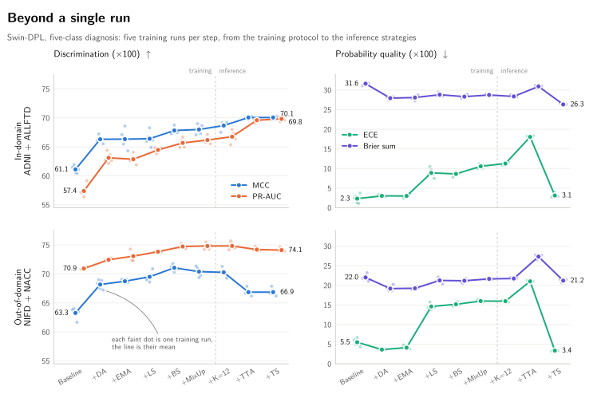

# Beyond a Single Run: Stabilizing and Evaluating 3D Vision Transformers for Neurodegenerative Disease Classification

**Official PyTorch implementation of the journal paper**  
*Beyond a Single Run: Stabilizing and Evaluating 3D Vision Transformers for Neurodegenerative Disease Classification*, submitted to the Journal of Machine Learning for Biomedical Imaging (MELBA) and currently under review.

[](#citation)
[](https://proceedings.mlr.press/v315/navet26a.html)
[](https://www.python.org/)
[](https://pytorch.org/)
[](LICENSE)

This branch is the code of the journal paper. It extends our MIDL 2026 paper, *On the Stability and Robustness of Vision Transformers for Neurodegenerative Disease Classification* ([PMLR 315:4518–4554](https://proceedings.mlr.press/v315/navet26a.html)), whose code remains on the [`midl`](https://github.com/EloiNavet/ViT-Stability-Neurodegeneration/tree/midl) branch.

---

## Overview

Vision Transformers are increasingly used to distinguish neurodegenerative diseases from structural MRI. Moving from a coarse task (cognitively normal, Alzheimer's disease, frontotemporal dementia) to a differential diagnosis that separates the three FTD phenotypes (behavioral-variant FTD, nonfluent and semantic variants of primary progressive aphasia) exposes rare and overlapping classes, and with them the variability between training runs. A single run may then not capture how reliable a model is.

The study trains each main configuration five times and evaluates it on an in-domain pool (ADNI and ALLFTD) and on external cohorts (NIFD and NACC). It separates the uncertainty due to the evaluated patients from the variability of training, and examines training interventions (augmentation, weight averaging, label smoothing, balanced sampling, MixUp), architectural modifications and inference strategies (test-time augmentation, checkpoint ensembling, temperature scaling) across five 3D backbones and an anatomy-driven SVM.

<p align="center">
  <picture>
    <source media="(prefers-color-scheme: dark)" srcset="assets/beyond_single_run_dark.svg">
    
  </picture>
</p>
<p align="center"><em>Swin-DPL, five-class diagnosis. Each faint dot is one of five training runs and the line is their mean. The cumulative training protocol raises MCC and PR-AUC in both domains, while single runs of neighboring steps overlap. Checkpoint ensembling and TTA add a further in-domain gain, but TTA lowers the external MCC. Label smoothing and MixUp make the network under-confident: its confidence falls below its accuracy, which raises the ECE. Temperature scaling corrects this without changing any prediction.</em></p>

---

## Key Findings

- **Finer diagnoses are harder and less stable.** Separating the FTD phenotypes lowers class-balanced discrimination for every architecture, and the instability concentrates in the rare phenotypes rather than in global metrics.
- **Augmentation is the most effective single intervention.** On Swin-DPL, domain-specific augmentation improves discrimination and lowers the training variability (normalized coefficient of variation, nCV) of calibration and of rare-phenotype recognition. The cumulative protocol reduces the nCV of rare-phenotype recognition by up to sevenfold, mostly through a higher mean F1.
- **Single runs can mislead.** Once training variability is accounted for, the apparent gains of most additions after augmentation are uncertain, and single-run significance tests can reverse with the runs compared.
- **Calibration is a separate property.** Label smoothing and MixUp make the network under-confident (in domain, mean confidence 0.72 for an accuracy of 0.82). Temperature scaling largely repairs it without changing any predicted label.
- **Inference gains do not always transfer.** Test-time augmentation with checkpoint ensembling gives the highest in-domain MCC and Macro-F1, but test-time augmentation lowers performance on the external cohorts.
- **The protocol transfers with architecture-dependent effects.** It also improves Swin, the CNN and the hybrid MedViT, whereas vanilla ViT remains the weakest backbone.

---

## Stabilization Framework

| Category | Components represented in this repository |
| --- | --- |
| **Architectures** | ViT-3D, Swin Transformer 3D, MedViT-3D, ResNet-18 3D (Swin-DPL: interface only) |
| **Data / sampling** | 3D augmentation, MixUp, class-balanced sampling |
| **Optimization** | Exponential Moving Average (EMA), Sharpness-Aware Minimization (SAM), label smoothing |
| **Architectural variants** | Post-normalization (Post-LN), ShakeDrop, stable initialization with rescaled residuals, LayerScale |
| **Inference** | Test-Time Augmentation (TTA), checkpoint ensembling |
| **Calibration** | Temperature scaling, ECE, Brier score |
| **Statistics** | Repeated training, normalized coefficient of variation, patient-cluster and hierarchical bootstraps, probability of false outperformance, McNemar tests (`analysis/`) |
| **Tasks** | 3-class (`CN`, `AD`, `FTD`) and 5-class (`CN`, `AD`, `BV`, `PNFA`, `SD`) classification, binary CN versus dementia |

The supplied configuration files provide the baseline of every backbone in both diagnostic settings and the configurations of every experiment of the paper (see [Available Configurations](#available-configurations)).

---

## Code Availability

This release contains the **training and evaluation framework** and the **statistics** of the paper.

### Included

- Full PyTorch training and evaluation pipeline.
- Standard 3D backbones used for the stability experiments.
- The configurations of the baselines and of every experiment of the paper.
- Stabilization components including EMA, SAM, MixUp, balanced sampling, and label smoothing.
- Inference utilities, including test-time augmentation.
- The statistics of the paper (metrics, bootstraps, nCV, PFO, McNemar, temperature scaling, disagreement) in `analysis/`.

### Not included

- **Swin-DPL (Deformable Patch Location):** the implementation used in the study is proprietary and is not distributed. The repository contains only an interface/placeholder for compatibility with the experimental framework.
- **AssemblyNet:** used as an external baseline and not distributed with this repository.
- **Data and predictions:** neither the cohort data nor the participant-level predictions of the study are distributed (see [Data Availability](#data-availability)).

---

## Statistics of the Paper

The paper evaluates every model from its saved predictions, over repeated training runs and with patient-level uncertainty. [`analysis/`](analysis) contains the functions that compute its numbers. They work on NumPy arrays: `y` (true class of each visit), `p` (predicted probabilities, visits × classes) and `patient` (patient of each visit, the resampling unit).

| Module | Computes |
| --- | --- |
| [`predictions.py`](analysis/predictions.py) | One prediction object per training repetition and domain: the ten in-domain (ID) test folds are concatenated, and the out-of-domain (OOD) probabilities of the ten fold models are averaged |
| [`metrics.py`](analysis/metrics.py) | Accuracy, MCC, Macro-F1, PR-AUC, top-label ECE (15 bins), NLL, Brier sum, Brier skill score, confidence deficit, per-class F1 and recall, five-to-three probability collapse |
| [`bootstrap.py`](analysis/bootstrap.py) | Patient-cluster bootstrap of one trained model (10,000 draws, all visits of a patient kept together), hierarchical bootstrap of configuration means over training repetitions, probability of false outperformance (PFO) |
| [`dispersion.py`](analysis/dispersion.py) | Normalized coefficient of variation, nCV = √N · s / mean, and its class-weighted version for per-class F1 |
| [`mcnemar.py`](analysis/mcnemar.py) | Exact McNemar test of two fixed models and Holm adjustment |
| [`calibration.py`](analysis/calibration.py) | Temperature scaling: cross-fitted in domain, transferred from ID to OOD |
| [`disagreement.py`](analysis/disagreement.py) | Modal agreement, variation ratio, vote entropy and Jensen–Shannon divergence between training repetitions |
| [`demographic_baseline.py`](analysis/demographic_baseline.py) | Diagnosis predicted from age, sex and cohort type only, on the folds of the networks |

```python
from analysis.predictions import assemble
from analysis.metrics import compute_metrics
from analysis.bootstrap import patient_bootstrap, percentile_interval, METRICS

classes = ("CN", "AD", "BV", "PNFA", "SD")
# the ten OOD prediction files of one training run
ood = assemble(ood_fold_files, "od", classes, patient_of)
print(compute_metrics(ood.y, ood.p))
draws = patient_bootstrap(ood, seed=20260926)
print(percentile_interval(draws[:, METRICS.index("mcc")]))
```

`patient_of` maps an acquisition (`Subject`) to its patient, from the metadata of its cohort. With the seeds given in the docstrings, the functions reproduce the intervals, effects and PFOs of the paper.

The ADNI, ALLFTD, NIFD and NACC data, and all participant-level predictions of the study, are **not distributed** with this repository (see [Data Availability](#data-availability)).

---

## Repository Structure

```text
├── analysis/            # Statistics of the paper, from saved predictions
├── configs/             # 3-class / 5-class experiment configurations
├── dataset/             # Data loading and preprocessing utilities
├── eval/                # Evaluation and metrics
├── models/
│   ├── medvit_3d.py
│   ├── resnet_3d.py
│   ├── swin_transformer_3d.py
│   ├── swin_transformer_dpl_3d.py   # interface / placeholder
│   ├── vit_3d.py
│   └── modules/
├── regularization/      # Regularization and stabilization components
├── scripts/             # Training orchestration scripts
├── train/               # Training code
├── utils/               # EMA, seeding, schedulers, helpers
├── config-defaults.yaml
├── requirements.txt
└── LICENSE
```

---

## Installation

### Requirements

- Python ≥ 3.9
- PyTorch ≥ 2.0
- CUDA ≥ 11.8 for GPU training

### Setup

```bash
git clone -b melba https://github.com/EloiNavet/ViT-Stability-Neurodegeneration.git
cd ViT-Stability-Neurodegeneration
pip install -r requirements.txt
```

The statistics of the paper (`analysis/`) need Python ≥ 3.10 and the packages of `requirements.txt`; run them from the repository root (`from analysis.metrics import compute_metrics`).

---

## Data Availability

The experiments use structural T1-weighted MRI from multiple research cohorts, including **ADNI**, **NACC**, **NIFD / FTLDNI**, and **ALLFTD**.

| Cohort | Access |
| --- | --- |
| **ADNI** | [adni.loni.usc.edu](https://adni.loni.usc.edu/) |
| **NACC** | [naccdata.org](https://naccdata.org/) |
| **NIFD / FTLDNI** | [ida.loni.usc.edu](https://ida.loni.usc.edu/) |
| **ALLFTD** | [allftd.org](https://www.allftd.org/) |

The aggregated imaging data cannot be redistributed through this repository because access is governed by the individual cohorts and their respective data-use agreements. Researchers should obtain the source datasets from the corresponding providers.

Participant-level predictions, caches and derived tables of the study are not distributed either; the functions of `analysis/` run on prediction files produced by the user.

---

## Data Preparation

### Preprocessing Assumption

The training pipeline assumes that input NIfTI files listed in the CSV metadata are **already anatomically preprocessed**.

- Registration and skull stripping are not performed by the training code.
- Input images should be registered to a common anatomical space and bias-corrected before training.
- The pipeline handles NIfTI-to-tensor conversion, intensity normalization, caching, and on-the-fly augmentation.

### Expected CSV Format

At minimum, CSV files should contain:

| Column | Required | Description |
| --- | --- | --- |
| `Subject` | Yes | Unique subject identifier |
| `Diagnosis` | Yes | Class label matching `DISEASES` in the configuration |
| `T1_path` | Yes | Path to the preprocessed T1-weighted NIfTI image |
| `Mask_path` | No | Optional brain-mask path |

### Cross-Validation Splits

Provide K-fold CSV files under `--training-csv-dir`:

```text
fold_0.csv
fold_1.csv
...
fold_K-1.csv
```

The configurations distributed with this release use the experiment definitions from the paper; avoid changing them when attempting to reproduce the reported setup.

---

## Available Configurations

Baseline configurations are provided for the standard backbones:

| Architecture | 3-class | 5-class |
| --- | :---: | :---: |
| ViT-3D | `vit-3c-no_seed-baseline.yaml` | `vit-5c-no_seed-baseline.yaml` |
| Swin Transformer 3D | `swin-3c-no_seed-baseline.yaml` | `swin-5c-no_seed-baseline.yaml` |
| MedViT-3D | `medvit-3c-no_seed-baseline.yaml` | `medvit-5c-no_seed-baseline.yaml` |
| ResNet-3D | `resnet-3c-no_seed-baseline.yaml` | `resnet-5c-no_seed-baseline.yaml` |

Swin-DPL configuration files are also retained for experimental compatibility, but the proprietary model implementation is not distributed.

### Configurations of the experiments

The configurations of the experiments were rebuilt from the resolved configurations logged for the runs of the study. Each one differs from the baseline of its backbone only in the values of the keys it changes.

| Experiment | Configuration files (`configs/`) | Changed keys |
| --- | --- | --- |
| Isolated interventions (Swin-DPL, 5 classes) | `swindpl-5c-no_seed-{dataaug,ema,label_smoothing,balanced_sampling,mixup}.yaml` | `USE_EXTENDED_DATA_AUGMENTATION`, `USE_EMA`, `LABEL_SMOOTHING: 0.15`, `USE_BALANCED_SAMPLER`, `USE_MIXUP` |
| Cumulative interventions (Swin-DPL) | `swindpl-5c-no_seed-dataaug-ema.yaml`, `…-dataaug-ema-label_smoothing.yaml`, `…-dataaug-ema-label_smoothing-balanced_sampling.yaml` | the switches above, added in this order |
| Full protocol (Swin-DPL) | `swindpl-5c-no_seed-dataaug-ema-label_smoothing-balanced_sampling-mixup.yaml` | all five interventions |
| Full protocol on other backbones | `{swin,vit,medvit,resnet}-5c-dataaug-ema-label_smoothing-balanced_sampling-mixup.yaml` | all five interventions |
| Checkpoint selection by validation MCC | `swindpl-5c-no_seed-dataaug-ema-label_smoothing-balanced_sampling-mixup-best_mcc.yaml` | `METRIC_BEST_MODEL: mcc` |
| Architectural ablations (one repetition each) | `swindpl-5c-{post_ln,shakedrop,stable_init,layerscale-fixed,sam}.yaml` | `POST_NORM`, `USE_SHAKEDROP`, `ENABLE_STABLE`, `LAYER_SCALE` (initial value 0.1), `USE_SAM` (ρ = 0.05, with `GRADIENT_CLIP: 1`) |
| Binary CN versus dementia | `{swin,swindpl,vit}-2c-baseline.yaml` | `DISEASES: ["CN", "DEM"]` |

The isolated, cumulative and full-protocol configurations keep the sixteen best checkpoints of each fold (`KEEP_BEST_N: 16`), which the checkpoint-ensemble analyses use. The `no_seed` configurations leave `SEED` unset. The architectural ablations and the binary baselines were trained once with `SEED: 42`. The alternative ADNI2+NIFD split of the paper uses `swindpl-5c-no_seed-baseline.yaml` and the Swin-DPL full protocol with the fold files of that split.

---

## Training

Example using the 5-class Swin Transformer baseline:

```bash
./scripts/transformer.sh \
    --training-csv-dir /path/to/Kfold_CV/ \
    --intermediate-dir /path/to/cache_dir/ \
    --eval-csv /path/to/test.csv \
    --save-dir /path/to/models/ \
    --runname my-experiment \
    --cuda-devices 0,1 \
    --config configs/swin-5c-no_seed-baseline.yaml
```

Useful options include:

| Option | Description |
| --- | --- |
| `--fold N` | Train a single cross-validation fold |
| `--checkpoint /path/to/model.pt` | Resume from a checkpoint |
| `--wandb-mode disabled` | Disable Weights & Biases logging |

---

## Evaluation

```bash
python -m eval.eval_transformer \
    --training-csv-dir /path/to/Kfold_CV/ \
    --intermediate-dir /path/to/cache_dir/ \
    --checkpoints /path/to/run_dir/model_<wandb_id>_<fold>_best*.pt
```

The repository contains utilities for predictive metrics, calibration assessment, and uncertainty analysis. The paper emphasizes that comparisons should not be interpreted from a single run alone: seed-level variation and patient-level uncertainty are central to the evaluation protocol.

---

## Reproducibility Notes

To reproduce the experiments on the standard backbones:

- Use the supplied `configs/*` files without modifying the experiment hyperparameters.
- Use the corresponding 3-class or 5-class disease definition consistently across folds and evaluation sets.
- Ensure that all images follow the same preprocessing and registration convention.
- The `*no_seed*` configurations reproduce the non-deterministic setting investigated in the paper, including TF32 / non-deterministic CUDA behaviour where configured.
- Cached preprocessing tensors are stored as `float16` tensors with shape `[1, D, H, W]`.
- Report variation across repeated runs rather than selecting a single favourable seed.
- `BATCH_SIZE` is a per-GPU batch size and `EFFECTIVE_BATCH_SIZE` (128) the effective batch obtained through gradient accumulation, so `BATCH_SIZE` can be adapted to the GPU memory.
- `train/train_svm.py` seeds the SVM classifier and its hyperparameter search (`--seed`, default 42). Repetition r of the SVM in the paper uses seed r, so each repetition is exactly reproducible.

Changes to the framework since the conference version ([`midl`](https://github.com/EloiNavet/ViT-Stability-Neurodegeneration/tree/midl) branch): training checkpoints record their cross-validation fold, and resuming from a checkpoint of another fold is refused. The bootstrap metrics use a local random generator and macro-averaged ROC-AUC and PR-AUC. The EMA refreshes BatchNorm statistics only for models that track them.

Base configuration: [`config-defaults.yaml`](config-defaults.yaml)  
Experiment overrides: [`configs/`](configs/)

---

## Citation

The journal paper is under review at MELBA, and its citation will be added here once it is published. The conference version is available at [PMLR 315:4518–4554](https://proceedings.mlr.press/v315/navet26a.html).

---

## License

This repository is released under the [MIT License](LICENSE).

Third-party notices and attributions are documented in [THIRD_PARTY_LICENSES.md](THIRD_PARTY_LICENSES.md).
